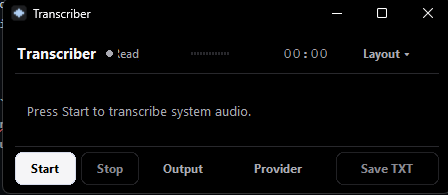
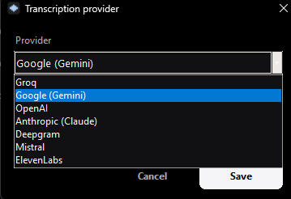

# Transcriber

[](https://www.python.org/downloads/)
[](LICENSE)

A Windows app that transcribes audio playing through your headphones or speakers. Choose the output device used by IVAO or another application, monitor audio activity, and export the transcript as a text file.

## Screenshots

**Main window**



**Provider selection**



## Getting started

1. Download `Transcriber.exe` from [Releases](../../releases) and run it.
2. Under **Provider**, choose a transcription service, paste your API key, and click **Save**.
3. Under **Output**, choose the audio device used by the application you want to transcribe.
4. Click **Start** to begin. Click **Stop** to finish and **Save TXT** to export the transcript.

Transcriber captures the audio Windows plays through the selected output device and preserves the spoken language. OpenAI Realtime displays partial transcripts as they arrive. Groq, Google Gemini, Deepgram, Mistral, and ElevenLabs update the transcript in chunks. The app stores its settings in a local `.env` file next to the executable. The repository's `.env.example` contains placeholder values.

## Development on Windows

Use 64-bit Python 3.11. To run the app from source or run the tests locally:

```powershell
python -m venv .venv
.\.venv\Scripts\python.exe -m pip install -r requirements.txt
.\.venv\Scripts\python.exe transcriber.py
.\.venv\Scripts\python.exe -m unittest discover -s tests
```

To build `dist\Transcriber.exe`:

```powershell
.\.venv\Scripts\python.exe -m pip install pyinstaller==6.22.3
.\build.ps1 -Python .\.venv\Scripts\python.exe
```

## License

This project is licensed under the [MIT License](LICENSE).
